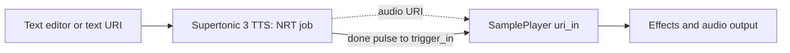

# Supertonic 3 integration design

Research date: 2026-10-11. Status: proposed design; no runtime implementation or model benchmark performed.

## Recommendation

Add `Supertonic3TTS` in the Offline category: text to a kept speech WAV, with a URI output and a one-block completion pulse. Use the upstream Python SDK in a supervised Python subprocess launched by an NRT worker. CPU inference is the initial supported backend.

Playback remains SamplePlayer's responsibility. This makes speech available to existing effects, recorders, and file-based analysis without adding a second playback implementation or running synthesis in `process()`.

The pulse establishes signal execution order; the URI carries only the file reference. SamplePlayer already loads changed URI paths on a trigger edge, performs NRT decoding/resampling, and automatically plays after loading. No SamplePlayer change is expected for the first version.

## Verified upstream facts

- Local ONNX inference, approximately 99 million parameters, 31 supported languages including Finnish, and inline expression tags. These are upstream capabilities, not measurements on this machine. [Model card](https://huggingface.co/Supertone/supertonic-3).
- Four ONNX files occupy approximately 398 MB together with configuration/index files: duration predictor, text encoder, vector estimator, and vocoder. [Asset listing](https://huggingface.co/Supertone/supertonic-3/tree/main/onnx).
- Source development/support has ended. Upstream now recommends archived assets pinned to `supertone-oss-archive/supertonic-3` revision `aafc6e32416a594460b32413efc49d7fe4ce6d46`, and SDK source revision `df0f9686dac7fbbde391b759e2ee5286a3737622`. The old model card's automatic-download example therefore should not be copied. [Archive setup](https://github.com/supertone-oss-archive/supertonic).
- The SDK accepts a local model directory, disabled auto-download, explicit ONNX thread counts, preset voices, and custom voice-style JSON. It returns a mono array and duration array, and internally chunks longer text. [Pinned SDK pipeline](https://github.com/supertone-oss-archive/supertonic-py/blob/df0f9686dac7fbbde391b759e2ee5286a3737622/supertonic/pipeline.py).
- Presets are M1–M5 and F1–F5. [SDK exports and example](https://github.com/supertone-oss-archive/supertonic-py/blob/main/supertonic/__init__.py).
- Model assets use OpenRAIL-M; source examples use MIT. Preserve the actual model license and attribution rather than inheriting the audio.cpp module's CC BY-NC wording. [Model license](https://huggingface.co/Supertone/supertonic-3/blob/main/LICENSE).

The archive's audio format is 44.1 kHz. Read the loaded runtime sample rate rather than assuming it; keep the source WAV at that rate and let `audio_io.to_engine_audio()` perform conversion to ANode's 48 kHz stereo format in SamplePlayer's NRT loader. Do not introduce a fractional resampler into block processing.

## Fit with current ANode code

Relevant inspected components:

| Component | Reuse |
| --- | --- |
| `audiocpp_backend.AudioCppJob` | Run/download/cancel dispatch, NRT job submission, status, artifact helpers |
| `audiocpp_backend.run_audiocpp_subprocess` | Hidden-window launch, cancellation, timeout, termination/reaping; already supports an alternate program label |
| `offline_job_widget.OfflineJobWidget` | Standard controls and telemetry; subclass for speech editor |
| `base.TriggerPulseMixin` | Trigger edge detection, queued parameter command, fully rewritten completion buffer |
| `core.NRTExecutor` | Per-node epochs and discarded-result delivery |
| `plugins/sample_player.py` | URI-triggered asynchronous load and playback |
| `audio_io.py` | Shared decode, channel adaptation, resampling, WAV writing |
| `download_util.py` | Explicit resumable, verified downloads |

The existing `anode-dev` environment includes ONNX Runtime, NumPy, soundfile, and resampy. Add a pinned Supertonic SDK dependency after checking its dependency resolution under Python 3.11. Prefer a release artifact demonstrably equivalent to the archived source pin; otherwise use the commit-pinned archive dependency. Do not run pip from a node's Download button.

Although its name is audio.cpp-specific, `AudioCppJob` is the required offline-job base and its job dispatch is usable here. Override `_build_fetch_payload()` to produce **model-only** downloads with an empty runtime list: the default implementation would otherwise fetch the CUDA audio.cpp runtime. Override `_build_spec()` so it does not instantiate or validate `AudioCppRuntime`. No base-class rename or architecture refactor is needed.

## Public node contract

Proposed class: `Supertonic3TTS`; label: `Supertonic 3 TTS`; category: `Offline`; `is_offline = True`.

| Port | Type | Behavior |
| --- | --- | --- |
| `trigger_in` | audio | Rising edge queues `("param", id, "generate", True)` |
| `text_uri` | URI input | Connected path overrides inline text; empty connected path fails clearly |
| `voice_style_uri` | URI input | Connected v3 style JSON overrides `voice_style_file` and preset; snapshotted at Generate |
| `audio` | URI output | Absolute path to the last successfully kept speech WAV |
| `done` | mono audio output | One block of 1.0 after a successful publication; otherwise zero |

Parameters:

- `text`: multiline UTF-8 speech text, initially empty. Preserve expression tags.
- `language`: fixed menu of supported codes plus `na` (language-agnostic fallback); initially `en`. Display language names with codes. Store the choice using ANode's established menu serialization.
- `voice`: M1–M5/F1–F5, initially M1.
- `voice_style_file`: optional local JSON overriding the preset. No recording-to-embedding pipeline in the initial version.
- `speed`: 0.7–2.0, initially 1.05; `total_steps`: 1–100, initially 8; `silence_duration`: nonnegative seconds, initially 0.3. These follow SDK defaults/constraints. [SDK configuration](https://github.com/supertone-oss-archive/supertonic-py/blob/main/supertonic/config.py).
- `model_dir`: initially `models/Supertonic3`; advanced `threads`: initially 2, constrained to a small positive range.
- `generate`, `download`, `cancel`: transient buttons; `last_wav`: persisted artifact reference.

Use `OfflineJobWidget` with a multiline editor modeled on the YuE2 widget's commit-before-action hook. Flush the edited text through the normal parameter queue before Generate, and flush before Save as required by coherent serialization. Workers never read Qt widgets or live parameters.

Do not add raw text ports, audio-rate speed/voice modulation, or streaming speech in this first change. URI text input already permits chaining from Qwen3 ASR's lyrics output. Include the companion voice-profile node below; recording-to-profile cloning needs an additional backend.

## Companion voice node: tuning and cloning feasibility

Scope updated following the user's request: a separate voice node belongs in the design. Distinguish reusable voice identity, synthesis delivery settings, and audio processing.

**Supported local route:** `Supertonic3VoiceProfile`, an Offline node selecting a shipped preset or importing an existing v3 voice-style JSON. Its Apply button or `trigger_in` edge schedules NRT validation and writes a unique kept profile artifact; output `voice_style` is a URI and `done` is a one-block pulse. Connect these to TTS `voice_style_uri` and `trigger_in`. A connected empty/invalid style must fail rather than silently fall back. Selection precedence is connected style URI, local style file, then preset. No style file I/O in `process()`.

The profile worker validates bounded file size, `style_ttl` and `style_dp` dimensions/data lengths, finite float values, and expected dimensions for the pinned v3 model. Schema compatibility alone does not prove that a v2 embedding is semantically suitable for v3; keep version/source provenance and require a known v3 profile. Preserve the imported arrays without arbitrary normalization. The SDK's loader consumes these two arrays directly. [Pinned loader](https://github.com/supertone-oss-archive/supertonic-py/blob/df0f9686dac7fbbde391b759e2ee5286a3737622/supertonic/loader.py).

**Voice tuning:** speed, chunk pauses, language, and expression tags remain synthesis controls. Pitch, formant, and timbre adjustments can use ANode's existing Vocal Transformer or WORLD Voice Transformer after SamplePlayer. These change generated sound; they do not train a speaker identity. Preset/style embedding interpolation is a possible experimental profile-node feature, but has no verified upstream quality guarantee. If explored, blend both compatible arrays with bounded coefficients and test the endpoints and intermediate voices; do not label it cloning or expose invented semantic embedding sliders.

**Recording-to-voice cloning:** the public Supertonic release does not contain an official recording-to-style pipeline. Its supplied assets are synthesis models and preset styles; importing a JSON is supported, extracting that JSON from a recording is the missing component. Historical Voice Builder links are not a dependable integration: the archive explicitly excludes that service and says historical hosted/support offers are no longer provided. [Upstream cloning and archive notes](https://github.com/supertone-oss-archive/supertonic).

Reserve `VoiceClone` as a separate Offline job node with `reference_audio_uri`, optional backend-specific transcript, `trigger_in`, Build/Cancel controls, profile/artifact URI output, and `done`. Do not register an operational Supertonic cloning node until a compatible encoder or training pipeline is identified and validated. An unrelated model's speaker embedding cannot be passed to Supertonic just because it is also an array or JSON.

If fully local cloning is required, the next research step is selecting a backend that actually ships reference-audio conditioning or speaker training. It may require its own TTS node and model-specific profile format. Reuse URI/NRT job mechanics while keeping backend compatibility explicit. Avoid claiming that converting between unrelated profile formats is possible without a demonstrated adapter.

Additional tests: profile URI precedence; malformed/oversized/non-finite embeddings; v3 provenance; profile Apply supersession and cancellation; publication before done; profile save/load without a pulse; complete Profile → TTS → SamplePlayer chaining. Real-voice cloning quality and similarity remain unverified until a cloning backend exists.

## Job and ownership sequence

1. At the command boundary, commit Generate and snapshot parameter values plus the current URI string into a plain job spec. Perform only cheap value validation here. File existence checks, text-file reads, JSON parsing, hashing, and asset validation belong to the worker.
2. Cancel the previous job through the base helper. Submit exactly one NRT job; additional submits for progress or cleanup would advance the node-wide epoch and invalidate the synthesis result. Capture progress epoch/inbox at submission if progress is added.
3. In the NRT worker, create a unique run directory, resolve UTF-8 text (connected URI wins), validate bounded input size, and write `request.json`. Use SDK-compatible limits and enforce a byte limit on file reads as well. Reject whitespace-only input and invalid settings with useful errors.
4. Launch `[sys.executable, worker_path, "--request", request_path]` through the existing subprocess supervisor, with `prog="supertonic3"`. Use the activated ANode environment's inherited PATH. Keep user text in the JSON file, never shell command text. Set a finite job timeout.
5. The child owns all SDK objects and ONNX sessions. Construct `TTS(model="supertonic-3", model_dir=..., auto_download=False, intra_op_num_threads=threads, inter_op_num_threads=1)`. Load the chosen voice locally; synthesize; verify output shape, finite values, sample rate, and positive length. Write `speech.wav` using the existing shared WAV helper, plus `metrics.json`.
6. The parent NRT worker validates child success and output, checks cancellation again, and atomically promotes the complete run into a unique kept directory. Return only paths and small metadata. Include model/SDK pins, settings, actual sample rate/duration, elapsed time, and output checksums in provenance. Duration metadata may need scalar extraction; do not format an SDK array as a scalar.
7. At `on_nrt_complete`, accept only the current request, publish the URI, persist `last_wav` through the established control-side pattern, then set `_pulse`. Never read/write files in this callback. A failed or cancelled job leaves the last successful artifact usable and emits no pulse.

Cancellation needs an explicit request identifier in addition to NRT epochs: the base Cancel action sets an event but does not submit a new job. A result already queued before Cancel can therefore still have the current epoch. The node's completion branch must reject a cancelled request even if its NRT epoch matches. New Generate/Download, deletion, and patch replacement must similarly prevent late results from publishing.

The subprocess can be terminated during an ONNX call, unlike an in-process SDK call, which has no cancellation argument. All waiting and process teardown occur on NRT. Session destruction occurs in the child. Initial tradeoff: model startup repeats for each request; measure cold startup before considering a persistent worker.

On stale/deleted completion, cleanup must be delegated to NRT, not performed synchronously in `on_nrt_discarded`. Adopt an explicit artifact policy: partial run directories are removed by workers; successful kept outputs remain until the user deletes them. Stale successful artifacts may remain unpublished for inspection. No open process/session handles are returned to the engine.

## Asset installation and save/load

Implement `supertonic3_fetch_specs()` using the archived immutable revision and per-file size/SHA-256 metadata. Required layout: `onnx/{duration_predictor,text_encoder,vector_estimator,vocoder}.onnx`, `onnx/tts.json`, `onnx/unicode_indexer.json`, `voice_styles/{M1..M5,F1..F5}.json`, and license/attribution files. Exact archive hashes and sizes must be collected before coding the manifest; the old namespace's listing is not an integrity manifest for the archive.

Download happens only through the explicit button or fetch CLI. Model files stay ignored, never bundled. Readiness means a worker verified the complete asset set; a partial download cannot become a loaded model. The UI should distinguish missing SDK, missing assets, malformed custom style, text errors, timeout, and inference failure.

Save controls and `last_wav`, never ONNX objects or pending job state. On restore, relink/validate the saved artifact through NRT after graph attachment; do not synthesize, download, auto-play, or emit a completion pulse. Clear transient triggers on restore. Missing kept outputs produce an actionable status. Transport restart clears pending pulse/edge state, and does not implicitly regenerate speech.

## Implementation slices and validation

1. Asset manifest/fetch CLI and SDK dependency pin. Verify archive availability, Windows CPU compatibility, licenses, and install with the activated `anode-dev` environment.
2. `supertonic3_backend.py` and `tools/supertonic3/worker.py`: pure request/argv builders, bounded file validation, subprocess supervisor, provenance, and output checks. Keep heavy SDK imports in the child.
3. `plugins/supertonic3_tts.py`: `AudioCppJob` subclass, model-only fetch override, immutable request snapshot, cancellation acceptance guard, completion publication, telemetry, and `OfflineJobWidget` subclass.
4. Example patch: TTS `audio` → SamplePlayer `uri_in`; TTS `done` → SamplePlayer `trigger_in`; SamplePlayer → audio output. Document explicit download and custom-style limitations.

Meaningful automated tests (mock SDK/subprocess for normal CI):

- Parameter/editor synchronization and immutable snapshots; URI precedence and empty-connected-input rejection.
- No default audio.cpp runtime download; pinned URL/hash handling, corrupt/partial assets, missing SDK.
- Generate twice, Cancel after result queueing, Download superseding Generate, deletion/reload: only an accepted current request publishes or pulses.
- Worker failure/timeout/cancellation always reaps the subprocess and leaves no published partial file.
- `done` shape remains `(1, BLOCK_SIZE)`, is cleared every block, and pulses exactly once; transport reset removes pending pulse.
- Save/load restores controls and artifact reference without regeneration or pulse; graph attachment precedes load work.
- Full TTS → SamplePlayer test with a small fixture at 44.1 kHz: NRT conversion yields finite 48 kHz stereo buffers; URI load auto-plays; EOF and subsequent silence contain no stale samples.

Optional real-model acceptance: short English and Finnish, numbers/punctuation, expression tags, multiple chunks, custom v3 style, offline execution with network disabled, cancellation during inference, and two TTS nodes. Record cold/warm latency, peak memory, synthesis RTF, and audio underruns with representative graphs. Start with two inference threads; choose concurrency limits only after measurement. GPU support and persistent workers are later options if measurements justify them.

No models were downloaded, dependencies installed, synthesis executed, or tests run for this design-only task. Main remaining empirical questions are cold-start cost, CPU contention during active playback, voice quality in Finnish, and compatibility of the archived SDK/model pair on this Windows environment.
